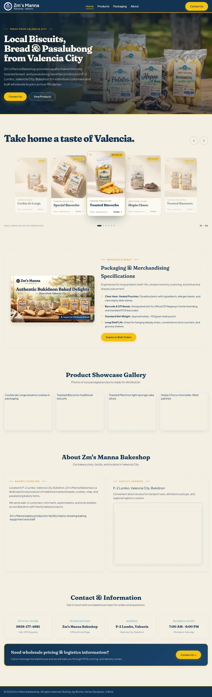

# Zm's Manna Bakeshop

> Small-batch biscuit, bread & pasalubong bakehouse — P-2 Lumbo, Valencia City, Bukidnon.

[](#) [](#) [](#license)



## About

Zm's Manna Bakeshop is a small-batch bakehouse in P-2 Lumbo, Valencia City, Bukidnon, serving biscuits, bread and pasalubong. This repository is the source for its public website — a single, fast, dependency-free static page built with plain HTML, CSS and JavaScript.

## Highlights

- **No build step** — open `index.html` in any browser and it works.
- **No dependencies** — no framework, no bundler, no npm install.
- **Responsive** — hand-tuned layouts for 360 / 768 / 1024 / 1440 px.
- **Accessible** — keyboard-navigable carousel, focus-trapped modal, reduced-motion support.
- **LCP-optimized** — banner image preloaded with high priority.

## Page sections

| Section | Description |
| --- | --- |
| `#home` | Full-bleed banner with brand tagline |
| `#products` | Product catalog carousel with modal detail view |
| `#packaging` | Packaging & merchandising specifications |
| Gallery | Product showcase grid |
| `#about` | The bakery story |
| `#contact` | Contact details, hours, address and map |
| Footer | Links, DTI note, credits |

## Getting started

```bash
# Serve the folder locally
python3 -m http.server 8899
# then open http://localhost:8899
```

Or just open `index.html` directly in your browser.

## Project structure

```
ZMs-Manna-Bakeshop/
├── index.html              # The whole page
├── styles/
│   ├── main.css            # Entry point (imports the rest)
│   ├── tokens.css          # Design tokens & reset
│   ├── components.css      # Reusable UI components
│   └── sections.css        # Page-specific sections
├── scripts/
│   └── catalog.js          # Product data + carousel/modal logic
└── assets/                 # Photos, logo, favicon, screenshot
```

## Tech stack

- **HTML5** — semantic markup, accessibility attributes
- **CSS3** — custom properties, grid, flexbox, container queries
- **Vanilla JavaScript (ES2020+)** — state, carousel, modal, focus management
- **Google Fonts** — Fraunces & Plus Jakarta Sans

## Stylesheet architecture

Styles load in this order via `@import` in `main.css`:

1. `tokens.css` — colors, spacing, typography, shadows, radii, transitions, z-index, breakpoints
2. `components.css` — buttons, cards, layout, header, footer, modal, grid
3. `sections.css` — banner, carousel, packaging, gallery, about, contact

Three rules hold it together:

1. **JavaScript owns state, CSS owns appearance.** JS toggles classes or sets custom properties; stylesheets react.
2. **One stylesheet per concern.** Tokens for decisions, components for reusable UI, sections for page-specific layout.
3. **Tokens carry the layout.** Spacing lives in `:root`; change the rhythm in one place.

## Editing cheat sheet

| Task | Where to edit |
| --- | --- |
| Change a colour or font | `styles/tokens.css` → `:root` |
| Change site-wide spacing | `styles/tokens.css` → `--gutter`, `--section-space`, `--grid-gap`, `--box-pad` |
| Add a button style | `styles/components.css` → `.btn` variants |
| Edit product names, photos, copy, gradients | `scripts/catalog.js` → `PRODUCTS` |
| Change hours / address / phone | `index.html` (contact section and footer) — keep in sync |
| Add a new section | Markup in `index.html`, styles in `styles/sections.css`, tokens in `tokens.css` |
| Change breakpoints | `styles/components.css` and `styles/sections.css` |

## Conventions

- **Class naming:** BEM — `.component`, `.component__element`, `.component--modifier`
- **Cards** separated by hairline borders, not heavy shadows
- **Copy** stays in the bakehouse's own register: location, hours, phone, DTI note, product notes
- **Semantic color aliases** in components (e.g. `var(--color-primary)`, never `#F4C10F`)

## Accessibility

- Every interactive element reachable by keyboard
- Visible focus (3 px gold outline) on all focusable elements
- Carousel: arrow keys, drag/swipe, dot navigation, `aria-roledescription="carousel"`
- Modal: focus trap, `Escape` to close, focus restoration, `aria-modal="true"`
- Meaningful `alt` text; decorative images `aria-hidden="true"`
- `prefers-reduced-motion` respected
- Heading hierarchy `h1` → `h2` → `h3` (no skipped levels)

## Verification

There is no build or test suite. Verify by hand:

1. Open `index.html` or serve with `python3 -m http.server 8899`.
2. Check at 360 / 768 / 1024 / 1440 px widths.
3. Tab through the page: header links, buttons, carousel controls, dots, modal (trap + Escape), confirm focus returns to trigger.
4. Toggle `prefers-reduced-motion` in DevTools and confirm content is still visible.
5. Confirm no console errors and no broken images.

## License

MIT — see [LICENSE](LICENSE) if present. Otherwise, all rights reserved by Zm's Manna Bakeshop.

## Contact

- **Address:** P-2 Lumbo, Valencia City, Bukidnon
- **Phone:** see contact section of the site
- **Website:** single-page site (this repo)
path: /home/anonymous/ZMs-Manna-Bakeshop/README.md